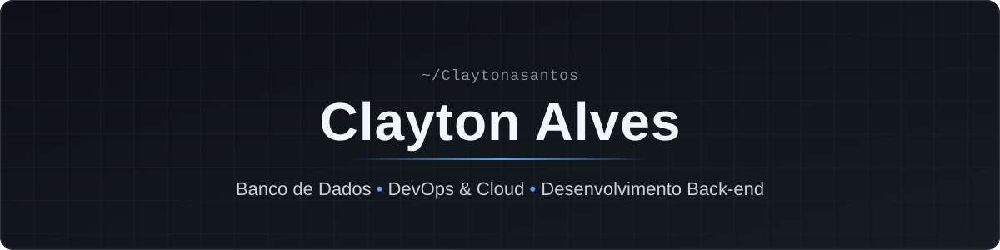
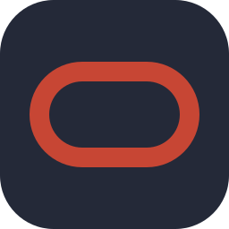

  

  

  
  

## Sobre mim

Olá! Sou Clayton Alves, estudante de Análise e Desenvolvimento de Sistemas na **FIAP**, com formação técnica em Desenvolvimento de Sistemas pela **ETEC**.

Tenho interesse em **Banco de Dados**, **DevOps** e **desenvolvimento back-end**. Venho desenvolvendo projetos acadêmicos com Oracle, SQL, PL/SQL, Java, Docker e Microsoft Azure, sempre buscando aprender e evoluir tecnicamente.

> 🚀 **Em busca da minha primeira oportunidade como Jovem Aprendiz em TI ou Trainee em TI.**

## Tecnologias

| Área | Tecnologias |
| :-- | :-- |
| **Banco de Dados** |   Oracle Database · SQL · PL/SQL · MySQL |
| **DevOps & Cloud** |  Microsoft Azure · Docker · Docker Compose · Linux · Git · GitHub |
| **Back-end e Programação** |  Java · Python |
| **Web** |  HTML · CSS |
| **Ferramentas** |  IntelliJ IDEA · Visual Studio Code |

## Atividade no GitHub

  
  

  
   
  Os dados são atualizados automaticamente a partir da atividade pública no GitHub, com cache de algumas horas. A animação de entrada dos cards é apenas visual: os números exibidos são sempre os valores reais.
   
  O nível é calculado pelo GitHub Readme Stats a partir de commits, pull requests, issues, revisões, estrelas e seguidores; não é uma posição em ranking oficial. As linguagens refletem o código dos repositórios públicos, incluindo projetos acadêmicos e de estudo.

## Projetos em destaque

### [GuiaPlus API](https://github.com/Claytonasantos/API_JAVA_GUIAPLUS)

Projeto acadêmico de impacto social voltado à redução do absenteísmo em consultas médicas, **finalista do NEXT FIAP 2025**. API REST em Java com Quarkus e Oracle Database, organizada em camadas de recursos, regras de negócio e DAO, integrada ao front-end da equipe e containerizada com Docker.

`Java 21` `Quarkus` `Oracle Database` `JDBC` `Docker`

### [DimDim API — KURAdevops](https://github.com/Claytonasantos/KURAdevops-cp5-webapp)

Projeto acadêmico em equipe de DevOps & Cloud. Minimal API em .NET com modelo de dados mestre-detalhe persistido no Azure SQL Database por meio de migrations do EF Core, publicada no Azure App Service com monitoramento pelo Application Insights. A infraestrutura é provisionada por um script idempotente em Azure CLI.

`Microsoft Azure` `Azure SQL Database` `Azure App Service` `Azure CLI` `.NET`

### [Desenvolva-se API](https://github.com/Claytonasantos/API_JAVA_DESENVOLVA_SE)

Projeto acadêmico com uma API REST em Java que atende ao front-end do Desenvolva-se, com endpoints de usuários, cursos, profissões e recomendações apoiados em Oracle Database. Containerizada com Docker.

`Java 21` `Quarkus` `Oracle Database` `JDBC` `Docker`

## Formação e certificação

- 🎓 **Análise e Desenvolvimento de Sistemas** — FIAP
- 🎓 **Técnico em Desenvolvimento de Sistemas** — ETEC
- 📜 **Python** — certificação pela FIAP

## Contato

Estou aberto a conversar sobre banco de dados, DevOps, cloud e desenvolvimento back-end. A melhor forma de falar comigo é pelo [LinkedIn](https://linkedin.com/in/clayton-alves-dos-santos-224281353).
